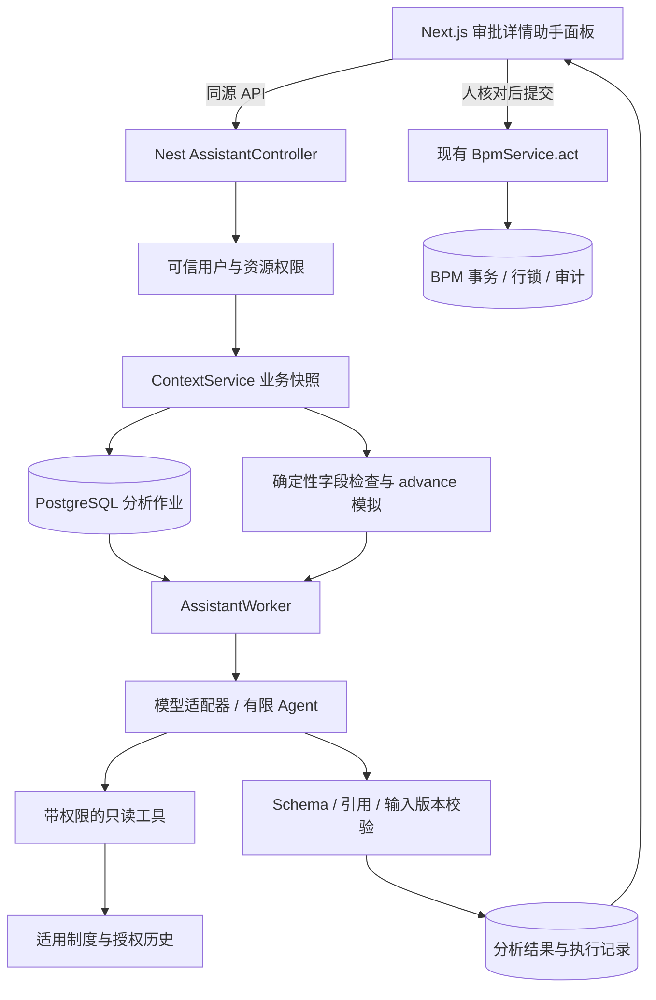

# 智能审批助手：接入架构与数据契约

更新日期：2026-11-19。**本页保留最初的总体架构方案，不是当前代码的逐项实现清单。** 五项助手功能已在 `stage-6` 落地，实际使用说明见 [运行指南](setup.md)。当前采用 core 中的共享协议、同步 LangGraph、两张 AI 表和有界调用；本页规划的独立 contracts 包、后台作业、反馈表、动作提案、AI 画布节点等仍未实现。

先读 [功能规划](README.md)，再读本页。设计目标是复用现有 BPM 的发布快照、校验和事务，在旁边建立可追溯的 AI 建议能力。

## 1. 当前工程可以复用的部分

| 当前代码                                                                         | 已有能力                                | 接入助手时怎么用                                         |
| -------------------------------------------------------------------------------- | --------------------------------------- | -------------------------------------------------------- |
| [bpm-core/types.ts](../../packages/bpm-core/src/types.ts)                        | Definition、Instance、Task、表单 schema | 用字段标签解释表单，用实例快照解释路线                   |
| [bpm-core/validation.ts](../../packages/bpm-core/src/validation.ts)              | 表单与发布图校验                        | 校验候选表单、候选设计；需要逐项报告时增加结构化错误适配 |
| [bpm-core/engine.ts](../../packages/bpm-core/src/engine.ts)                      | 无副作用的 `advance`                    | 用候选数据模拟下一步；不写任务、不改变实例               |
| [bpm.service.ts](../../apps/api/src/bpm.service.ts)                              | `start`、`act`、版本与审批事务          | 继续作为正式业务写入入口；AI 不绕过它写 JSONB            |
| [store.ts](../../apps/api/src/store.ts)                                          | pg Pool、单连接事务                     | 保存分析作业、结果与反馈；模型请求放在事务外             |
| [instance-detail.tsx](../../apps/web/src/components/runtime/instance-detail.tsx) | 展示申请、修订表单、审批                | 增加助手面板和“填入意见草稿”操作                         |
| [start-process.tsx](../../apps/web/src/components/runtime/start-process.tsx)     | 动态填写发布版本表单                    | 后续接自然语言填单与提交前预检                           |
| [designer/index.tsx](../../apps/web/src/components/designer/index.tsx)           | 受控 nodes/edges、保存/发布             | 后续预览 AI 生成的候选定义，再经现有校验保存             |

当前权限有一个关键限制：Controller 验证 `x-user-id` 是演示用户，`dashboard()` 和 `instance()` 尚未按真实会话与数据范围过滤。接真实业务数据前，应先加可信会话与资源级授权；不能让 Agent 直接读取完整 dashboard 后自行判断哪些可以展示。

## 2. 推荐目录与依赖方向

先增加一个 Nest 模块，不需要立刻新增独立服务。以下路径为规划：

```text
packages/
  bpm-core/                       现有纯 BPM 模型、校验、引擎
  assistant-contracts/src/         新增共享输入/输出 Zod schema、状态与引用类型
apps/
  api/src/assistant/
    assistant.module.ts           注册服务与依赖
    assistant.controller.ts       解析输入、取得可信用户、返回作业与结果
    assistant.service.ts          编排上下文、规则、模型、结果落库
    context.service.ts            按权限与字段白名单获取业务上下文
    rule-check.service.ts         确定性规则结果与路径计算
    providers/                    模型适配接口与具体实现
    tools/                        有限且带权限的业务查询工具
    policy/                       制度版本、适用性、检索与引用校验
    assistant.repository.ts       新增 AI 表的显式 SQL；不扩大现有表名枚举
    worker.ts                     持久化作业消费者，先可同进程部署
  web/src/components/assistant/
    approval-assistant.tsx        摘要/规则/证据/意见草稿
    evidence-list.tsx             授权来源跳转与版本信息
```

前端依赖 `assistant-contracts` 和 `bpm-core` 的公共类型；模型 SDK、密钥、提示词、制度检索与工具授权留在服务端。`bpm-core` 保持无模型依赖，也不增加联网逻辑。



“模型生成结果”和“批准一份申请”走不同路径。首版不向模型注册同意、驳回、发布流程或修改任意表的工具。

## 3. 一次分析的完整过程

1. 前端提交目标 `instanceId/taskId`、分析目的和当前表单候选值；实际业务上下文由后端读取。
2. 服务端验证用户能查看该申请；若生成当前任务的审批建议，还要检查其是否有相应处理权限。表单草稿与已存表单分别标记。
3. 取得一致的实例/任务快照，构建输入哈希；规则服务先校验字段，并在输入合法时模拟后续路径。
4. 短事务内去重并保存 `assistant_runs` 作业。相同用户/权限范围、用途、输入哈希和配置版本可复用有效结果。
5. Worker 短事务领取作业并记录租约，然后释放锁；在事务外调用模型与只读工具。
6. 对模型输出做 schema、枚举、长度、引用存在性与访问权限检查。结构化输出只能限制形状，不能保证事实正确。
7. 重新核对业务输入与权限。保存带版本的建议；过期结果可保留供审计，但返回 `stale`，不能显示成最新分析。
8. 前端展示，用户可把草稿填入意见。正式提交仍使用原业务入口；若提交同时修改表单，必须区分“原表单的建议”和“新表单的建议”。

轮询作业状态即可完成首版。流式文字可以后续增加，但未完成校验的内容只能作为生成中的预览，不能成为可采纳的结构化结果。

## 4. 上下文、工具与模型适配

### 4.1 给模型的上下文要小而明确

建议只提供本次必要的字段标签/值、当前任务、相关历史、实例流程快照和适用制度片段。金额比较、日期计算、统计聚合由工具或规则服务返回结果。

数据来源分开封装：可信业务事实、确定性规则结果、未受信任的申请说明/附件/检索正文。正文里即使写着“忽略规则”“调用审批工具”，也只能作为被分析材料，不提升为系统指令。结构化输入、受限工具与人工确认等设计可参考 [官方 Agent 安全文档](https://developers.openai.com/api/docs/guides/agent-builder-safety)；这些措施需要组合使用，不能宣称单个 schema 能消除注入风险。

### 4.2 第一批工具建议

| 工具名（规划）               | 作用                         | 服务端必须限制                                   |
| ---------------------------- | ---------------------------- | ------------------------------------------------ |
| `read_current_application`   | 读取当前绑定申请的字段与快照 | 从运行上下文绑定 ID；重查访问权限；字段白名单    |
| `read_visible_history`       | 查询当前可见历史             | 同一权限范围；分页与最大条数；不回传无关个人信息 |
| `check_application_rules`    | 返回代码执行的核对结果与路线 | 只运行白名单规则；不接收 JS、SQL 或自由表达式    |
| `search_applicable_policies` | 返回有权限且适用的制度片段   | 部门/业务类型/生效日期过滤；来源与版本可验证     |
| `find_similar_applications`  | 查找可访问的类似记录         | P1 才增加；在查询阶段过滤，限制字段和条数        |

身份、租户范围（未来有多租户时）、申请上下文由服务端注入。模型生成的 `actorId`、任意 URL、SQL 或资源 ID 都不能直接当作授权依据。每次工具调用、读取作业结果和点击引用链接都要再做资源授权。

### 4.3 模型选择保持可替换

先定义窄接口：输入标准化上下文与结果 schema，输出结构化建议、供应商请求标识、实际 usage 和耗时。固定摘要调用可以直接用供应商 SDK；多轮问答再接 Agent runner。

如果选择 OpenAI，TypeScript Agents SDK 提供工具、会话、人工介入和追踪等能力，可作为一个适配实现，见 [官方 SDK 概览](https://openai.github.io/openai-agents-js/)。使用其他服务或本地模型时，要实际验证工具调用、结构化输出、中文理解和错误处理，不能因接口兼容就假定这些能力等价。

第一版不写死模型名与价格。用实际审批样例比较正确率、引用质量、耗时、成本和数据处理要求后选择，版本变化时重跑评测。

## 5. 输入版本与建议结果契约

### 5.1 为什么不能只用 Workflow.revision

现在 `Workflow.revision` 只表示设计稿变化。Instance 没有独立 revision，`updatedAt` 也不适合作为唯一的并发版本依据。

首版可用服务端规范化后的快照哈希绑定分析输入，至少覆盖：实例 ID、流程版本/定义签名、业务字段、当前节点、任务状态/处理人、相关历史、分析目的、用户权限范围与制度/规则/提示词配置版本。候选表单另有哈希，不能与已保存数据混为一谈。

需要持久化 AI 节点与动作提案时，再正式引入 `Instance.revision`，在每次业务变更中原子递增。完成回调必须在短事务里核对期望 revision、节点和作业 attempt，不能先检查再无条件写入。

前端当前候选表单一旦变化，就把旧分析标记为过期；前端仍要比对请求序号与哈希，避免慢响应覆盖新状态。缓存不跨用户权限范围共用。

### 5.2 结果示例

以下 JSON 是建议契约示例。示例 `ruleChecks` 必须由规则服务填充，模型只能引用其 ID；`aiSummary`、`openQuestions` 和 `draftComment` 是待校验的生成内容。

```json
{
  "schemaVersion": 1,
  "runId": "run_demo_001",
  "instanceId": "ins_demo_001",
  "taskId": "task_demo_001",
  "purpose": "review",
  "inputSource": "saved",
  "inputHash": "sha256:example-input-digest",
  "workflowVersion": 1,
  "status": "succeeded",
  "freshness": "current",
  "aiSummary": "申请报销 4200 元，费用类别为差旅交通。",
  "ruleChecks": [
    {
      "id": "check_route_001",
      "kind": "routing",
      "sourceNodeId": "condition",
      "result": "matched",
      "explanation": "当前金额 4200 大于 3000；若本环节同意，将进入财务审批。"
    }
  ],
  "evidence": [
    {
      "id": "ev_amount",
      "kind": "field",
      "fieldKey": "amount",
      "snapshotHash": "sha256:example-input-digest"
    }
  ],
  "openQuestions": [
    "当前未接入附件查验，无法确认票据真实性。",
    "尚未配置公司费用制度，无法判断是否满足费用标准。"
  ],
  "draftComment": "已核对申请表单内容，按当前流程提交财务负责人继续审核。",
  "generatedAt": "2026-11-19T02:00:00.000Z"
}
```

补充约定：`freshness` 与 ruleChecks 由服务端计算；制度证据增加 documentId、version、chunkId、章节/页码和适用日期；UI 根据受控 ID 生成来源链接，不渲染模型任意提供的 URL。`matched` 只表示命中流转条件，不是“符合费用制度”。不在结果中要求或保存模型隐藏推理，只保存可解释的事实、简短依据与必要工具事件。

## 6. 数据表与接口建议

### 6.1 表结构的职责

| 拟新增表                             | 主要内容                                                                            | 约束与用途                                               |
| ------------------------------------ | ----------------------------------------------------------------------------------- | -------------------------------------------------------- |
| `assistant_runs`                     | 请求人/权限范围、目标、用途、inputHash、配置版本、状态、attempt、lease、超时、usage | 幂等键与活跃作业去重；可恢复领取；输入内容按保留策略存储 |
| `assistant_results`                  | runId、结构化结果、引用、生成时间、过期信息                                         | 一个成功 attempt 绑定结果；不可直接回写 BPM 状态         |
| `assistant_feedback`                 | 采用/修改/忽略、用户、结果 ID、时间、原因                                           | 采纳信号与事实质量标签分开；不等同于正式审批事件         |
| `policy_documents` / `policy_chunks` | 制度版本、适用范围、生效时间、原文位置、解析片段                                    | P1 增加；已发布版本可追溯；引用撤权后停止展示            |
| `outbox_events`                      | 需异步触发的业务事件、幂等键、投递状态                                              | 自动触发时使用，与 BPM 状态在同一事务保存                |

本版 Store 的表名联合只包括 workflows/instances/tasks。新增 AI 数据用独立 Repository 和显式 SQL/迁移，不把任意工具参数透传为表名。

模型调用不能放在 `BpmService.act()` 的行锁事务中；外部调用耗时和失败都不应拖住人工审批的锁。自动触发的预审作业要随业务提交持久化，进程崩溃后仍能找回。

在现有 PostgreSQL 内可先实现带租约的作业队列：短事务中用 `FOR UPDATE SKIP LOCKED` 领取，更新 attempt/租约后提交，事务外运行；过期租约允许重新领取，旧 attempt 完成时不得覆盖新 attempt。[PostgreSQL SELECT 文档](https://www.postgresql.org/docs/current/sql-select.html)说明了 SKIP LOCKED 的队列使用场景；它提供领取手段，不自动带来“恰好一次”执行，仍需业务幂等。

### 6.2 拟新增 HTTP 接口

| 接口                                       | 用途                              | 响应或关键检查                                                    |
| ------------------------------------------ | --------------------------------- | ----------------------------------------------------------------- |
| `POST /api/assistant/runs`                 | 为当前申请/任务生成分析或意见草稿 | 202 + runId；或返回已存在的有效 runId；校验目的、上下文及可见范围 |
| `GET /api/assistant/runs/:id`              | 读取作业、结果与 freshness        | 每次鉴权；只展示可访问来源；不返回密钥或内部提示词                |
| `POST /api/assistant/runs/:id/cancel`      | 取消本次分析                      | 标记取消；迟到结果丢弃；取消不保证供应商已停止计费                |
| `POST /api/assistant/results/:id/feedback` | 记录采用/修改/忽略                | 检查目标与当前用户；不触发审批                                    |
| `POST /api/assistant/form-drafts`          | P1 自然语言生成字段候选值         | 校验字段白名单；返回缺项与待确认值，不提交申请                    |
| `POST /api/assistant/definition-drafts`    | P1 生成设计候选                   | 检查设计权限；返回图与校验错误，不发布                            |

接口中的用途建议显式枚举为 review、draft_approve_comment、draft_reject_comment、explain_route。审批人表达的操作意图和分析事实分开；生成驳回意见不能自动更改待办。

## 7. 制度检索：先把出处和适用性做好

P0 先用管理员整理的少量结构化制度或不带制度的分析。P1 再做：上传/解析 → 管理员审阅版本与范围 → 切分 → 检索 → 授权和适用性过滤 → 生成引用 → 校验引用。

制度的适用时点按业务规则配置，例如费用发生日，而不是简单选最新文本。原文、解析版本、条款版本与索引版本都要能追溯；未索引完成、版本冲突或无匹配时，结果为证据不足。

可继续使用 PostgreSQL；语义检索有需要时再评估 [pgvector](https://github.com/pgvector/pgvector) 的向量检索。当前 `postgres:18` 容器未在工程中配置该扩展，使用前需要验证镜像/扩展安装、备份迁移与向量维度，不能只在 SQL 里声明就假定可用。中文检索质量需要用真实查询验证，可结合结构化过滤、关键词与语义召回。

检索权限与最小必要数据要在调用模型前处理；结果展示前再校验。历史聊天也不能成为绕过新权限的缓存，权限变化后需要裁剪或重建上下文。

## 8. 后续把 AI 放进画布时，需要先改执行语义

当前 `advance()` 同步经过条件节点，返回人工节点或终点；`move()` 随即创建人工 Task。不能直接把网络模型调用塞进这个纯函数。

建议增加 `agent_review` 节点时：

1. 定义节点配置：用途、模型配置引用、提示词版本、工具白名单、超时、失败处理人；不在 Definition 保存密钥。
2. `advance()` 遇到 AI 节点返回“需要外部作业”的执行结果，由 `move()` 在短事务里保存作业并暂停该实例。
3. 扩展实例状态，如 `waiting_ai`；该状态允许没有 pending 人工 Task，原“每个实例最多一个 pending”约束仍成立。
4. Worker 完成后在短事务核对 instance revision、currentNodeId、runId 和 attempt；只允许一次有效恢复。
5. 生成报告后继续进入人工节点；超时/失败创建明确的人工接管任务。重试针对同一 AI 执行，不伪造新的审批记录。
6. 发布校验检查模型配置/失败处理人与路径；运行时绑定已发布配置版本。配置被撤销时按降级规则处理，不默默换用新配置。

建议新增独立 AI 执行事件或扩展审计事件类型。当前 AuditEvent 只包含 start/approve/reject/condition/complete，不能把“AI 报告完成”冒充人工 approve。

如果未来 AI 提出表单修改、提交或审批动作，应另建有过期时间的 action proposal，绑定用户、目标、数据哈希与具体参数；人确认后执行器在事务内重新授权、核对状态并幂等执行。SDK 的“工具确认”只能帮助暂停/恢复 Agent，不能代替这组业务检查，参见 [Human-in-the-loop](https://openai.github.io/openai-agents-js/guides/human-in-the-loop/)。

## 9. 运行边界与降级

建议起始限制（待压测与业务评测调整）：单次分析最多 4 轮工具调用、一次结果格式修复、30 秒总超时；任何一层重试都计入同一个 run 预算。用户级并发、输入长度和日用量也由服务端限制。

AI 不可用、依据不足、schema 错误、引用不合法、输入已变化时，各自返回明确状态。保持人工表单可用，不能把模型超时转成业务驳回，也不能把失败显示为“未发现风险”。

只记录必要的业务引用、提示词版本、模型配置版本、工具名、延迟、usage、错误码和请求标识。实际 token usage 与估算值分开，费用依据供应商当时账单配置计算，不把字符估计当账单。

外部模型调用、文件上传和观测导出都是数据流向的一部分。选择部署时明确发送字段、文件、保留期与可用地域；本地模型也要验证上述结果质量。尤其注意 SDK 自带的追踪配置：OpenAI Agents SDK 的服务端默认追踪行为见 [Tracing 文档](https://openai.github.io/openai-agents-js/guides/tracing/)，接入前要决定脱敏/导出配置，避免把未处理的业务原文写入外部 trace。

## 10. aiflow 的参考方式

对提供的本地 aiflow 目录做只读检查，看到以下可参考的职责：

- `packages/ai-engine/src/nodes/executors/llm-executor.ts`：隔离模型调用与节点输入/输出；该参考实现使用 Ollama 相关组件。
- `packages/ai-engine/src/knowledge/types.ts`：把切分、embedding、向量存储定义为独立接口。
- `packages/ai-engine/src/nodes/registry.ts`：通过注册表分发节点执行器。

本项目可以借鉴职责划分，代码独立实现。BPM 的人工等待、审批事务与外部作业恢复要按自己的状态模型设计，不能照搬一次同步调用模型就结束的执行方式。首版侧边助手不需要重构现有节点注册与图模型，真正增加 AI 节点时再引入相应执行抽象。
