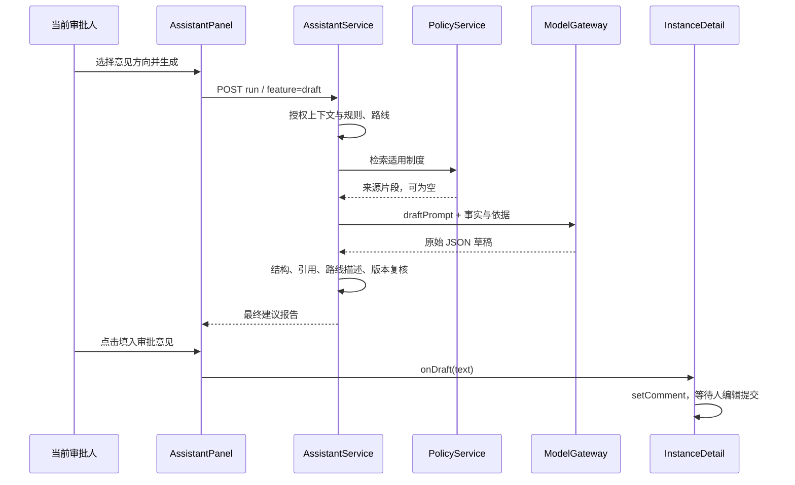

# 01 · 审批意见草稿：从申请事实到可编辑意见

[学习总入口](README.md) · 前置：[基础篇](00-foundations.md) · 理解路线后阅读更容易

## 一、本篇目标

跟踪一次 `feature=draft`，弄懂申请内容怎样变成草稿，以及为什么“模型建议同意”“填入审批意见”“同意并流转”是三个不同动作。

例子：林晓申请报销 4200 元差旅交通费，目前轮到陈亦舟处理。陈亦舟想先生成一段意见，再核对修改。

## 二、先理解三个新概念

**上下文**是这次起草可以参考的资料：实例自己的流程定义、当前表单、已有规则结果、代码模拟的路线和检索到的制度。不是把所有数据库内容全部发给模型。

**意见方向 `intent`** 表示想起草同意意见还是驳回原因。它只影响文案任务，不是业务接口中的实际审批指令。

**人工采纳**表示人读过建议后，把它复制到可编辑的意见框。真正提交还有独立按钮和接口。

| 动作                   | 发生的变化                             |
| ---------------------- | -------------------------------------- |
| 生成审批意见草稿       | 调用助手，生成并保存建议报告           |
| 填入审批意见，继续核对 | 更新页面 `comment` 状态，意见仍可编辑  |
| 同意并流转 / 驳回申请  | 调业务审批接口，检查待办并改变实例状态 |

## 三、把链路拆成七步



### 第一步：详情页决定是否提供起草入口

打开 [instance-detail.tsx](../../../apps/web/src/components/runtime/instance-detail.tsx)，搜索 `canAct`、`canDraft`、`onDraft`。

`canAct` 需要申请仍在运行，且 pending 待办的处理人是当前用户。页面据此展示起草选项。前端这样做是方便用户；服务端仍会重新授权。

### 第二步：面板收集起草请求

打开 [assistant-panel.tsx](../../../apps/web/src/components/assistant/assistant-panel.tsx)，搜索 `generate` 和 `intent`。主要输入如下，示例 ID 是结构说明，实际请求会使用页面中的真实值：

```json
{
  "feature": "draft",
  "instanceId": "当前申请的真实ID",
  "intent": "approve",
  "text": "请重点提醒核对出行材料",
  "model": { "provider": "ollama", "model": "qwen3.5:2b" }
}
```

审批人在编辑表单时，面板还会传整份候选 `data`。这里的 `data` 代表完整分析输入，不是只改一项的 PATCH；省略时后端读取已保存表单。

### 第三步：prepare 读取真实实例并检查当前处理人

打开 [assistant.service.ts](../../../apps/api/src/assistant/assistant.service.ts)，先找 `context()` 的 `input.instanceId` 分支。

服务端先读取申请与任务，检查当前用户是否参与过该申请；起草还要满足当前 pending 待办属于本人。使用的是 `instance.definition`，因此后面设计器改了新版本，也不会偷偷替换这份旧申请的流程。

### 第四步：rules 与 retrieve 准备材料

`rules` 用代码检查字段并尝试解释路线。`retrieve` 调 `PolicyService.search()`：优先使用补充说明作为检索词；没有补充说明时，用流程名称与表单字段拼成查询。

适用日优先取表单的 `date`，否则使用当前上海日期。即使没查到制度，draft 仍可以基于申请事实起草；不能因此声称“符合某项制度”。这与制度问答没有来源就停止模型生成的逻辑不同。

### 第五步：generate 只让模型做文案工作

打开 [prompts.ts](../../../apps/api/src/assistant/prompts.ts)，找到 `draftPrompt`。再回 Service，看传入模型的 `payload`：

| 输入                  | 提供什么                 |
| --------------------- | ------------------------ |
| `fields`              | 当前申请/候选表单事实    |
| `rules`               | 代码已发现的问题         |
| `route`               | 代码模拟结果，供参考     |
| `sources`             | 本次检索到的真实制度片段 |
| `intent` / `userText` | 起草方向和补充说明       |

提示词要求起草本环节意见，不自行推导后续节点，不宣称票据已经验真。模型经 [model-gateway.ts](../../../apps/api/src/assistant/model-gateway.ts) 调用，原始 JSON 进入 `generated`，还不能直接显示成可信结果。

### 第六步：validate 过滤明显不支持的内容

在 Service 中搜索 `state.input.feature === 'draft'`，有两个重点：

1. 如果文案点名了不在当前代码路线中的审批节点，会拦截。例如低金额本不走财务，却写“提交财务负责人审批”。检查依赖节点名称匹配，不能理解成通用语义真伪证明。
2. 如果匹配到“符合公司标准”等未经现有规则证明的肯定表述，会回退为表单事实与待核实意见，并写入 warning。这也是针对特定表达的兜底，不代表已核验所有自然语言结论。

随后复核申请快照和被引用制度是否仍适用，保存到 `assistant_reports`。不会在这里调用 `bpm.act()`。

### 第七步：onDraft 只修改页面意见框

回到详情页：

```ts
setComment(text.slice(0, 1000));
```

这一步没有 `request()`，没有审批写库。真正的提交在详情页 `submit()`，它请求 `/tasks/${task.id}/actions`，由原 BPM 服务处理权限、事务和流转。

## 四、亲手验证与练习

### 页面实验

1. 用林晓提交一份 4200 元费用申请；这一步是你显式创建教学申请。
2. 切换陈亦舟，进入该待办，选择“审批意见草稿”，方向选同意，使用本机模型生成。
3. 看 Network：生成请求是 `assistant/run`。
4. 点击“填入审批意见，继续核对”。意见框出现文字，但顶部仍是待处理，历史没有新增“已同意”。
5. 手工修改意见。只有点击“同意并流转”后，才出现 `tasks/.../actions` 请求，并进入模板配置的后续环节。

模型措辞不是固定答案。你要验证的是“引用可查看、意见可编辑、采纳没有审批、业务按钮才流转”。

### 接口实验：只起草，不审批

先执行基础篇的公共函数，在同一个 PowerShell 中运行。选中陈亦舟当前的一条 pending 待办；没有时先完成上面的第 1 步。

```powershell
$lessonDashboard = Invoke-RestMethod "$lessonApi/dashboard" -Headers @{'x-user-id'='u-chen'}
$lessonPending = $lessonDashboard.tasks | Where-Object {
  $_.status -eq 'pending' -and $_.assignee -eq 'u-chen'
} | Select-Object -First 1
if (-not $lessonPending) { throw '请先用林晓发起申请，让陈亦舟获得待办。' }
$lessonInstanceId = $lessonPending.instanceId

$draftResult = Invoke-AssistantLesson -UserId 'u-chen' -Payload @{
  feature = 'draft'
  instanceId = $lessonInstanceId
  intent = 'approve'
  text = '根据已知事实起草，提醒核对材料'
  model = @{ provider = 'ollama'; model = 'qwen3.5:2b' }
}
$draftResult | Select-Object text, questions, warnings, sources | ConvertTo-Json -Depth 12
```

预期返回可编辑草稿，若回退则有 warning，待办仍为 pending。使用林晓对同一个实例调用 draft 应被拒绝，因为申请人并不等于当前审批人。

### 从测试学习

读 [API 助手测试](../../../apps/api/test/assistant.test.ts) 中这三个用例：

- `draft requires current assignee and persists advice without approving`：先看断言如何证明没有审批。
- `draft route claims are checked against the engine rather than trusting the model`：模型替身故意写错路线。
- `unsupported compliance conclusions fall back to verifiable application facts`：故意生成合规断言，观察回退。

练习：先写出“申请金额是 4200”和“4200 符合费用标准”有什么区别，再对照答案：前者可回溯到字段；后者还需要真实适用标准与核验逻辑，仅有金额字段不足以推出。

## 五、常见问题

| 问题                       | 原因与处理                                           |
| -------------------------- | ---------------------------------------------------- |
| 看不到草稿选项             | 不是当前处理人，或申请已经结束；先核对 `canAct`      |
| 选驳回方向会直接驳回吗？   | 不会，只改变生成任务；实际驳回需要独立业务提交与原因 |
| 没有制度仍能生成？         | draft 允许按事实起草，制度问答才要求命中来源后生成   |
| 点填入后建议显示过期？     | 表单/身份等分析输入变了，重新生成再采纳              |
| 模型漏写事实或意见不准确？ | 结构与部分规则检查不能保证语义全部正确，必须人工修改 |

读懂本篇后，再用 [RAG 篇](04-policy-rag.md) 展开第四步的“制度从哪来”。
