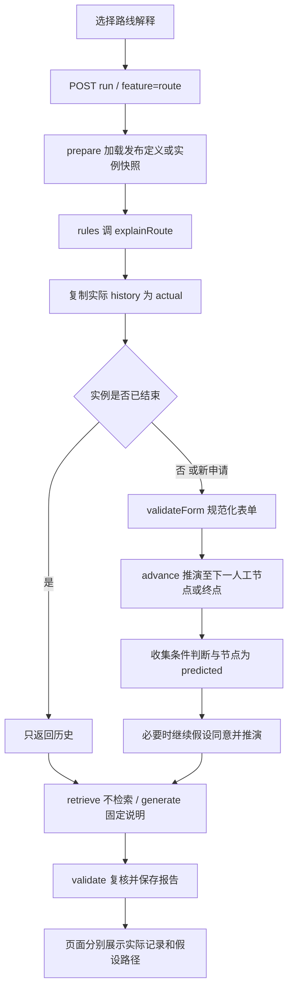

# 02 · 路线解释：代码怎样算出下一步

[学习总入口](README.md) · 前置：[基础篇](00-foundations.md)

## 一、本篇目标

不用启动对话模型，也能解释一份申请已经走到哪、假设后续审批都同意会走到哪。能说清“历史事实”和“未来模拟”的区别。

内置报销模板的关键规则是 `amount > 3000`。部门负责人同意后，满足条件进入财务审批，否则结束。3000 是演示流程路由阈值，不是费用合规上限。

## 二、先理解三个概念

**流程定义 `Definition`** 像路线图，包含节点、连线和字段要求。画布上的节点位置不决定执行顺序，连线和条件才决定。

**实例快照**是发起申请时保存的那版路线图。解释旧申请时必须使用旧快照，否则会拿今天修改的流程解释昨天发生的事情。

**纯函数**只根据传入参数计算结果，不调用网络、不写数据库。`explainRoute()` 和引擎 `advance()` 是这条链路的核心；HTTP 外层仍负责读库、授权和保存报告。

| `mode`      | 页面显示 | 来源                                          |
| ----------- | -------- | --------------------------------------------- |
| `actual`    | 实际记录 | 实例里已经保存的 `history`                    |
| `predicted` | 假设路径 | 当前表单 + 纯引擎计算，假设后续人工审批都同意 |

## 三、从按钮追到纯引擎



### 第一步：页面发送功能和分析目标

在 [assistant-panel.tsx](../../../apps/web/src/components/assistant/assistant-panel.tsx) 搜索 `needsModel`，确认 `route` 不要求模型。

发起页传 `workflowId` 和当前 `data`，因此全部是发起前模拟。详情页传 `instanceId`，由后端加载历史和快照；当前审批人可以分析尚未提交的候选表单，其他参与人读取已保存值。

### 第二步：rules 调 explainRoute

在 [assistant.service.ts](../../../apps/api/src/assistant/assistant.service.ts) 找 `.addNode('rules'`，再跳到 [assistant-checks.ts](../../../packages/bpm-core/src/assistant-checks.ts) 的 `explainRoute()`。

按这个顺序阅读：

1. `instance.history.map(...)`：直接复制真实记录，并标记 `actual`。
2. `instance.status !== 'running'`：已完成/驳回的申请只返回历史，没有未来步骤。
3. `validateForm(def.fields, data)`：检查必填、日期、选项与数字，并规范化值。不能拿空字符串猜金额路径。
4. `from`：新申请从 start 节点开始，运行中申请从当前节点开始。
5. `for` 循环：反复调用 `advance()`，把条件判断和到达节点记为 `predicted`。

代码是在内存里假定人工节点同意，再继续推演；没有创建新的 Task，也没有补写历史。

### 第三步：advance 执行流程条件

打开 [engine.ts](../../../packages/bpm-core/src/engine.ts)，搜索 `advance`，再看 [templates.ts](../../../packages/bpm-core/src/templates.ts) 的 `amount` 和 `gt`。

`advance` 从一个节点沿连线前进，跨过自动条件节点，在下一人工审批节点或终点停下。返回两类东西：`transitions` 是途中条件判断；`next` 是本段停在哪里。

对未修改的内置报销模板，假设当前停在部门负责人：

```text
amount = 3000
部门负责人（假设同意）→ 金额判断不满足 > 3000 → 流程结束

amount = 3000.01
部门负责人（假设同意）→ 金额判断满足 > 3000 → 财务负责人（假设同意）→ 结束
```

这不是模型理解的结果。更换 Ollama 模型不会改变条件比较。如果你修改了模板条件，就以该版本的实际定义为准。

### 第四步：后面节点保持确定性处理

回 Service 的 `retrieve`，route 返回空来源；在 `generate` 返回“实际历史与后续模拟分开展示”的固定说明。随后仍进入 `validate` 复核输入版本并保存报告。

前端只在 `result.feature === 'route'` 时展开 `result.route`，用 `step.mode` 显示“实际记录/假设路径”。详情页另有 [route-preview.tsx](../../../apps/web/src/components/runtime/route-preview.tsx) 的流程展示；学习助手请求时先跟 `AssistantPanel → result.route`，避免把两个入口混在一起。

## 四、亲手验证与练习

### 页面实验：对比临界值

1. 用林晓进入费用报销发起页，手工填写全部必填项，金额先填 3000。
2. 选择路线解释并生成，确认没有财务假设节点。
3. 把金额改为 3000.01。旧建议应显示过期，重新生成后应出现财务假设节点。
4. 整个过程中不点击“提交申请”，因此不会新建实例。
5. 查看 Network：有助手请求，没有模型服务密钥，也没有业务发起请求。

页面仍会读取公开配置/模型列表，这不代表 route 调用了对话生成；以 Service 分支和返回的 `model`、`steps` 一起判断。

### 接口实验：同一输入只改变金额

先在同一个 PowerShell 执行基础篇的公共函数。以下日期仅用来提供合法字段，不参与金额条件。

```powershell
$routePayload = @{
  feature = 'route'
  workflowId = $lessonWorkflowId
  data = @{ category = '差旅交通'; amount = 3000; date = '2026-11-18'; reason = '客户现场交付' }
}
$routeLow = Invoke-AssistantLesson -Payload $routePayload
$routeLow.route | Format-Table mode, label, detail

$routePayload.data.amount = 3000.01
$routeHigh = Invoke-AssistantLesson -Payload $routePayload
$routeHigh.route | Format-Table mode, label, detail
```

预期：使用默认模板时，仅高金额结果经过财务；新申请的路线全部是 `predicted`，不会冒充已经审批。无需 `model` 参数。

### 用最小测试理解条件

```powershell
pnpm --filter @bpm/core exec tsx --test --test-name-pattern 'route explanation' test/assistant.test.ts
```

预期该路线用例通过。读 [共享包测试](../../../packages/bpm-core/test/assistant.test.ts) 的同名测试：怎样构造定义、传两个金额、断言是否包含 finance。

练习：表单还没填完就请求路线，应该硬猜路径还是返回无法模拟？答案是后者。当前 Service 捕获模拟错误，在 `warnings` 中解释，`route` 可能为空。生成说明存在不代表每个未来节点都成功算出。

## 五、常见问题

| 问题                               | 原因与处理                                                         |
| ---------------------------------- | ------------------------------------------------------------------ |
| 为什么说“假设同意”？               | 后续人工决定尚未发生，模拟必须公开自己的前提                       |
| 已驳回的申请为什么没有下一步？     | 终态只展示历史，不能把它当作运行中继续推演                         |
| 修改设计器后，旧申请路线没有改变？ | 旧实例保留发起时快照，这是版本隔离的目的                           |
| 金额大于 3000 是否违规？           | 当前只定义路由条件，没有据此定义费用上限                           |
| 为什么有步数上限？                 | 防止异常定义导致模拟无尽执行；合法发布流程按当前模型应为无环串行图 |

下一步建议读 [异常字段检测的规则部分](05-anomaly-detection.md)，继续理解无需模型也能完成的业务判断。
