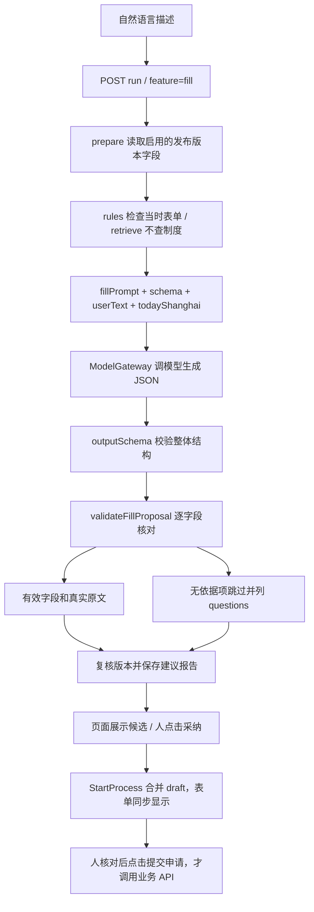

# 03 · 自然语言填单：从一句话到候选字段

[学习总入口](README.md) · 前置：[基础篇](00-foundations.md)

## 一、本篇目标

跟踪一次 `feature=fill`，理解“模型提取”和“代码核对”怎样合作。能解释 `qwen3.5:2b` 曾经为什么报“缺少有效字段或原文依据”，以及现在如何保留有依据的部分结果。

全文用这句描述：**“昨天差旅交通费420元，用于项目交付。”** 假设服务端上海日期为 `2026-11-20`，日期候选应为 `2026-11-19`。实际运行时“昨天”始终随运行当天变化，不会固定使用本文日期。

## 二、先分清字段、值和证据

表单 schema 描述“允许填什么”，自然语言描述“用户说了什么”，模型把两者关联起来。

| 对象         | 例子             | 意义                         |
| ------------ | ---------------- | ---------------------------- |
| 字段 `key`   | `amount`         | 程序读写数据的名称           |
| 展示 `label` | `报销金额（元）` | 页面显示给人看的文字         |
| 类型 `type`  | `number`         | 允许什么类型的值             |
| 候选值       | `420`            | 提取结果，数字字段应返回数字 |
| 原文依据     | `420元`          | 用户实际说过的连续文字       |
| 日期候选值   | `2026-11-19`     | 转成表单需要的日期格式       |
| 日期原文依据 | `昨天`           | 换算前的真实表达             |

`fieldEvidence.amount` 和 `fields.amount` 必须使用同一个业务 key。不能用中文 label 代替 key，也不能把“用户输入的金额数字”当作原文。

证据能回溯不等于理解一定正确。例如从一段话里找到了 420，不等于程序已经证明它是报销总额而不是另一项费用；采纳前仍需核对语义。

## 三、从输入框追到受控表单



### 第一步：发起页提供 schema 与采纳回调

打开 [start-process.tsx](../../../apps/web/src/components/runtime/start-process.tsx)，搜索 `draft`、`AssistantPanel`、`onFill`。

页面读取当前流程最新发布版本，用 `definition.fields` 渲染动态表单，并把字段列表和 `workflowId` 传给助手。页面给的字段主要用于显示；后端会重新读取发布版本，不信任浏览器擅自改过的定义。

### 第二步：prepare 读取可用版本

在 [assistant.service.ts](../../../apps/api/src/assistant/assistant.service.ts) 找 `context()` 的 `workflowId` 分支：流程需要已发布并启用，填单描述不能为空。

`rules` 仍会检查此刻的表单。刚打开时表单可能空，因此可能出现“表单不完整，不能模拟路线”的 warning；后面提取出的候选值由专门函数再检查，不应把这个提前的 warning 当成全部提取失败。

`retrieve` 对 fill 返回空来源，这条功能不依赖公司制度库。

### 第三步：generate 给模型一份专用提取任务

Service 为填单单独构造上下文：

```text
feature: fill
schema: 当前发布表单的字段定义
userText: 用户的申请描述
todayShanghai: 服务端的上海业务日期
```

在 [prompts.ts](../../../apps/api/src/assistant/prompts.ts) 找 `fillPrompt`：字段必须来自 schema，下拉值来自 options，没说明的事实留空，日期需规范化，依据必须保留原文。

这里不把当前空表单当作主要提取材料，避免小模型误以为“表单没有值，所以原文也没有值”。

### 第四步：生成时先限制可能的输出

在 [output-schema.ts](../../../apps/api/src/assistant/output-schema.ts) 看 `decodingSchema()` 的 fill 分支。Ollama 原生 format 约束了三件事：

1. `fields` 的 key 只能来自当前表单；select 值限制在真实 options。
2. `fieldEvidence` 的 key 同样来自表单，值从真实用户输入片段中选择。短输入可能引用整段原文，这仍然是可回溯的来源。
3. 明确识别出日期时，把日期值限制在代码解析得到的候选中，包括按上海日期换算的“昨天”。

这主要改善小模型生成质量，不取代下一步校验；OpenAI 兼容服务也必须经过下一步。

### 第五步：validateFillProposal 逐项检查与恢复依据

打开 [fill-validation.ts](../../../apps/api/src/assistant/fill-validation.ts)，按以下顺序读，不用一开始就记住所有正则：

| 函数/位置                            | 先理解的问题                                         |
| ------------------------------------ | ---------------------------------------------------- |
| `fillEvidenceCandidates()`           | 怎样把真实输入变成可选的引用片段，长输入如何覆盖末尾 |
| `normalize()` / `mentionAt()`        | 全角数字规范化后，如何还原到原文字符位置             |
| `datesIn()` / `fillDateCandidates()` | 中文日期、月日和相对日期怎样转成规范值               |
| `numbersIn()`                        | 怎样识别完整数字、千分位、小数、明确的万/千/百单位   |
| `literalEvidence()`                  | 怎样定位真实摘录，同时容忍空白/兼容字符差异          |
| `validateFillProposal()`             | 怎样保留可验证子集，把其余项变成待确认               |

主函数的处理顺序：

1. 检查字段是否定义，未知 key 忽略。
2. 用共享 `validateForm()` 检查该字段类型、选项、日期等。
3. 数字/日期必须在原文中找到相同的完整值或可确定换算的日期；日期中的年月数字不会恢复成金额。
4. 原证据不存在时，尝试从真实输入重新找同值数字/日期，或文本的字面值。
5. 文本/分类的真实引文仍需人工判断是否支持该语义；没有真实引文且字面值也不存在时，不凭相似含义编造依据。
6. 无法核对的项跳过；保留其他项，补充必填缺项与推定年份提示。

`reason` 还有一个有限兜底：模型遗漏时，可以复制原文中已知“，用于…”或“，用途为…”的用途短语。它不是可随意改写事实的第二个模型。

### 第六步：修复前后有什么变化

旧情况可能是：

```json
{
  "fields": { "amount": 420, "date": "2026-11-19" },
  "fieldEvidence": {
    "amount": "用户输入的金额数字",
    "date": "根据今天解析昨天"
  }
}
```

金额/日期看似正确，但两条“证据”不是用户原文。旧逻辑会拦截整份结果。现在先在生成时限制真实依据，再在收到后逐字段核对；能够重新找到 `420` 和 `昨天` 时恢复它们，找不到时单独跳过。

必须继续拦住这些情况：

| 用户原文 / 模型候选                 | 当前处理                             |
| ----------------------------------- | ------------------------------------ |
| 原文 420，候选 999                  | 金额跳过                             |
| 原文 1420，候选 420                 | 不能拿数字内部子串作依据，跳过       |
| 原文昨天，候选错误年份              | 不匹配时跳过，不把错误日期悄悄当正确 |
| 原文只写 11月20日                   | 可按当前年推定，但必须提示核对年份   |
| 一项分类无法核对，其余金额/日期有效 | 返回有效子集，分类列为待确认         |
| 所有候选无法核对                    | 返回空候选和问题清单，不自动填默认值 |

### 第七步：采纳后只是合并页面值

回到发起页，看核心语句：

```ts
setDraft((previous) => ({ ...previous, ...result.fields }));
```

旧值在前、有效候选在后，所以被跳过的字段保留人工原值；返回的同 key 候选会覆盖原值，采纳前要核对。`FormFields` 的受控模式读取这份 state，才能立即展示 AI 候选。

真正点击“提交申请”时，`collectFields()` 从表单收集值，通过业务 API 创建实例，并再次执行服务端表单校验。

## 四、亲手验证与练习

### 页面实验

1. 用林晓进入费用报销发起页，选 `ollama / qwen3.5:2b`。
2. 输入本篇例句并生成。检查候选金额、日期和各自原文。
3. 暂不采纳，观察申请表单没有因此自动提交。
4. 点击“确认候选值并填入表单”，检查控件更新，再手动调整说明。
5. 不点“提交申请”时，工作台不会多出这份新申请。

模型可能选择不同的文字摘录，或对某项给出待确认。这不是固定字符串对比实验，重点是合法字段、真实依据与明确缺项。

### 接口实验

先执行基础篇的公共函数：

```powershell
$fillResult = Invoke-AssistantLesson -Payload @{
  feature = 'fill'
  workflowId = $lessonWorkflowId
  text = '昨天差旅交通费420元，用于项目交付。'
  model = @{ provider = 'ollama'; model = 'qwen3.5:2b' }
}
$fillResult | Select-Object fields, fieldEvidence, questions, warnings | ConvertTo-Json -Depth 12
```

金额应能提取为 420，日期随当前上海日期换算；没有依据的字段应在问题中提示，而不是凭空补全。

### 用稳定测试研究错误情形

```powershell
pnpm --filter @bpm/core build
pnpm --filter @bpm/api exec tsx --test test/fill-validation.test.ts
```

预期八项填单回归测试通过，无需调用真实模型、无需数据库。这些测试传入固定提案，便于稳定观察错误候选；真实模型输出不适合用来复现每一次特定错误。

练习：打开 [fill-validation.test.ts](../../../apps/api/test/fill-validation.test.ts)，先看第一条“解释性证据恢复”测试，再看第二条“只跳过一项”。用自己的话写出：为什么不能恢复 999，为什么分类缺证据不应拖垮金额？

## 五、常见问题

| 问题                              | 先检查什么                                                 |
| --------------------------------- | ---------------------------------------------------------- |
| 日期为什么不是本文的 2026-11-19？ | 本文固定了讲解用的“今天”，真实运行按服务端当日换算         |
| 引用整段话是否出错？              | Ollama schema 允许真实片段，短文可能整段引用；仍需核对语义 |
| 为什么分类还需确认？              | 选项合法和原文支持是两层判断；缺证据不能强行推断           |
| API 返回空 fields 算失败吗？      | 表示本次没有可核验候选，查看 questions 补充描述            |
| 模型连接/JSON 报错还会出现吗？    | 会，这是调用或结构问题，区别于逐字段缺少依据               |
| 为什么填入后还要服务端校验？      | 候选采纳不是提交，提交时还需验证最终人工编辑结果           |

下一篇可读 [意见草稿](01-approval-draft.md)，比较“填字段”和“填意见”共同的人工采纳设计。
