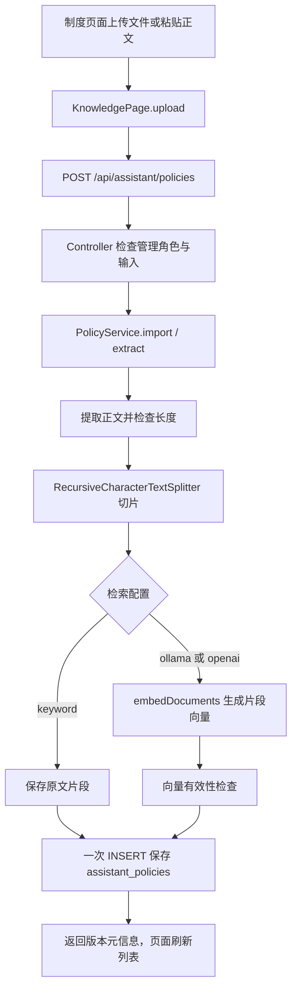
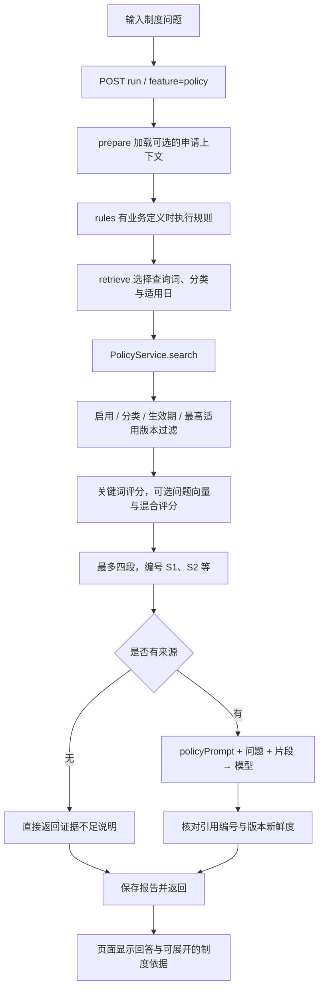

# 04 · 审批制度 RAG：先把文档存好，再带依据回答

[学习总入口](README.md) · 前置：[基础篇](00-foundations.md) · 本篇包含两条独立链路

## 一、本篇目标

能分别说清楚“导入制度时发生什么”和“用户提问时发生什么”，知道制度文字存在哪里、模型看到哪些片段，以及为什么聊天模型与向量模型是两种配置。

问题示例：**“差旅交通费报销需要哪些材料？”** 制度参考工程里的 [演示差旅制度](../../examples/expense-policy.md)。该文件只是教学材料，不是任何公司的真实政策。

## 二、先用查书理解 RAG

没有 RAG 时，模型只能根据输入和训练知识回答，它并不知道你公司的最新制度。RAG 相当于先打开指定书库，找出与问题相关的几段，再让模型参考这些段落回答，并把出处给人看。

| 概念            | 用查书来理解           | 当前实现                       |
| --------------- | ---------------------- | ------------------------------ |
| 解析            | 把书里的字读出来       | TXT/MD 解码，DOCX/PDF 提取文字 |
| 切分 chunk      | 把长书拆成可定位的小段 | 目标片段长度 800，重叠 120     |
| 索引            | 为“以后怎样找”准备资料 | 保存正文片段；可附加向量       |
| 检索 retrieval  | 选出与问题相关的段落   | 关键词或向量混合排序，最多四段 |
| 生成 generation | 按找到的资料组织回答   | `policyPrompt` + 所选对话模型  |
| 引用 citation   | 标出回答参考哪段       | 本次来源编号 S1、S2 等         |

**向量不是制度正文，也不是模型写的摘要。** Embedding 把文字变成数字数组以比较相似性，聊天模型把材料组织成语言。当前默认关键词模式不调用 Embedding，也属于先检索再生成的 RAG。

## 三、分别追踪两条链路

### A 链：导入时，准备以后能查的资料



**第一站：前端 `upload()`。** 打开 [knowledge-page.tsx](../../../apps/web/src/components/assistant/knowledge-page.tsx)。它收集标题、版本、分类、生效期和内容。选择文件时转为 Base64 放进 JSON，有文件优先解析文件，否则提交粘贴正文。

Base64 是文件字节的传输编码，不是 Embedding。浏览器检查 4MB 是为了及时反馈，服务端还要重新检查，不能只依赖前端。

**第二站：Controller 的 `import()`。** 打开 [assistant.controller.ts](../../../apps/api/src/assistant/assistant.controller.ts)，搜索 `@Post('policies')`。只有陈亦舟或王知远的演示角色可以导入/启停；林晓可以问答。它不经过助手的五节点图，这是单独的制度管理接口。

**第三站：`PolicyService.import()` 与 `extract()`。** 在 [policy.service.ts](../../../apps/api/src/assistant/policy.service.ts) 搜索这两个方法：

| 格式          | 怎样提取                               |
| ------------- | -------------------------------------- |
| UTF-8 TXT、MD | 从文件字节解码为文字                   |
| DOCX          | `mammoth.extractRawText()`             |
| 文本 PDF      | `PDFParse.getText()`，完成后释放解析器 |
| 扫描图片 PDF  | 本版没有 OCR，需先转成可提取文字       |

正文限制为 20～120000 字符，最多 200 个片段。切分参数 `chunkSize=800`、`chunkOverlap=120` 是目标长度与重叠，实际片段会受段落和中文标点影响，不要求每段刚好 800 字。

重叠用来保留边界上下文，例如一条材料要求跨越片段边界时，减少被完全割裂的概率。它不能保证任意问题都能正确召回。

**第四站：可选 Embedding 与保存。** `embedDocuments(texts)` 在 keyword 模式返回 null；向量模式为每段生成向量并校验数量和数值。失败就结束导入，不保存半成品。

最终一个制度版本的正文、parts、可选向量和索引 profile 一起保存到 PostgreSQL `assistant_policies.document` JSONB。元信息包括标题、版本、分类、生效期、启用状态、创建人和片段数。列表 API 剔除正文和向量，避免每次刷新发送整库内容。

同标题、同分类、同版本由数据库唯一索引限制。更新正文要导入新版本，不原地改写旧版本。

### B 链：提问时，检索适用来源再生成



**第一站：问答入口。** 独立制度库里的 `AssistantPanel policyOnly` 只传问题，不隐式附带某个业务实例；申请页面问制度则有该流程/实例上下文。

**第二站：选择检索范围。** 在 [assistant.service.ts](../../../apps/api/src/assistant/assistant.service.ts) 的 retrieve 中：

- 查询词优先用用户问题。
- 有业务定义时使用该业务分类，否则为 `all`；独立问答可检索多个业务类别，不要误以为默认只查报销。
- 表单里有形如 YYYY-MM-DD 的 `date` 时优先按该日选制度，否则按当前上海日期。

**第三站：先判断适用性，再算相似性。** 在 `PolicyService.search()` 中，先筛启用状态、类别和生效日期，再在同标题/分类里选适用的最高启用版本。之后才按相关性排片段，避免一条失效制度因为很相似而混进来。

关键词模式的 `terms()` 使用英文数字词、中文单字和相邻双字组合，如“差旅”“报销”。当前不是真正完整的中文分词系统。

向量模式额外调用 `embedQuery()`，只比较同一索引 profile、兼容维度的向量。评分取关键词分数和“语义 0.8 + 关键词 0.2”的混合分数中较高者，再按阈值过滤、降序取前四段。先理解先后顺序，不必背公式；分数是排序依据，不是答案正确率。

**第四站：没有来源就不让模型补公司政策。** generate 中 `feature=policy && !sources.length` 直接构造证据不足说明。此时没有对话生成。请注意，向量查询配置不可用会在检索时报错，与“成功检索但没有命中”不同。

**第五站：有来源才生成，并核对编号。** 模型返回 `text` 与 `citationIds`，例如：

```json
{
  "text": "根据演示制度，应说明发生日期、出行目的和相关项目，并提交交通票据供核对。[S1]",
  "citationIds": ["S1"]
}
```

这只是输出结构示例，不是固定模型答案。`S1` 是本次检索后分配的临时编号，下一次可能代表另一段；它不是数据库主键。

validate 拦住不存在的引用，且有来源的制度回答不能完全不引用。随后复查引用制度是否被停用、是否出现新的适用版本。最终 `result.sources` 只保留实际引用并通过检查的来源，不是所有检索候选。

前端展示标题、版本、片段号和真实正文。片段号不是 PDF 页码。引用编号存在也不自动证明每句话都被条文支持，仍需人展开核对。

### 模型配置怎样影响这两条链

打开 [model-gateway.ts](../../../apps/api/src/assistant/model-gateway.ts)，比较 `generate()` 与 `embedDocuments()`/`embedQuery()`。

| 配置                                    | 控制什么               | 更改后的影响                |
| --------------------------------------- | ---------------------- | --------------------------- |
| 页面 provider/model                     | 用什么对话模型组织答案 | 不会自动重建已存制度索引    |
| `ASSISTANT_EMBEDDING_PROVIDER=keyword`  | 用关键词检索           | 不需要向量模型              |
| `...=ollama` + `OLLAMA_EMBEDDING_MODEL` | 用本地向量模型         | 导入和查询都要向量服务      |
| `...=openai` + `OPENAI_EMBEDDING_MODEL` | 用兼容向量服务         | 服务必须实际支持 embeddings |

索引 profile 包含 provider、服务地址和向量模型名。更换向量配置后，旧索引不跨空间做比较，仍可能关键词召回；新版本重新导入才能建立新向量。当前向量存 JSONB、在 Node 中扫描计算，没有使用 pgvector 索引。

## 四、亲手验证与练习

### 页面实验：先用默认关键词模式

1. 按 [配置指南](../setup.md) 使用 keyword 模式，修改服务端配置后重启 API。
2. 切换陈亦舟，进入“智能助手 · 制度库”。
3. 导入 `docs/examples/expense-policy.md`，分类选费用报销，版本用尚未使用的正整数，生效日设 `2020-01-01`。
4. 等待“制度已导入并完成索引”，确认列表出现版本及片段数。重复同标题/分类/版本应提示冲突，而不是覆盖。
5. 选择本机对话模型，问“差旅交通费报销需要哪些材料？”。展开依据，逐项对照材料要求。
6. 在 Network 分别找到导入的 `assistant/policies` 和问答的 `assistant/run`；它们不是同一个请求。

如果试验停用制度，记录是哪一份教学文档，结束后可重新启用。存在其他版本/通用制度时，停用某一版不保证整个问题没有依据。

### 接口实验：查询，不重复导入

先完成基础篇公共函数和上面的导入步骤：

```powershell
$policyResult = Invoke-AssistantLesson -Payload @{
  feature = 'policy'
  workflowId = $lessonWorkflowId
  text = '差旅交通费报销需要哪些材料？'
  model = @{ provider = 'ollama'; model = 'qwen3.5:2b' }
}
$policyResult | Select-Object text, sources, questions, warnings | ConvertTo-Json -Depth 12
```

预期：命中制度则有可展开的来源；没有适用命中则明确证据不足。模型原始字段叫 `citationIds`，最终响应通过 `sources` 提供来源详情，两者不要混为一谈。

### 不依赖模型的稳定验证

阅读 [API 助手测试](../../../apps/api/test/assistant.test.ts)，先看：

- `RAG filters category, effective dates, latest enabled version and exposes source text`：分类、生效期和版本如何决定可用来源。
- `RAG abstains on no evidence and blocks fabricated citations`：没有来源时怎样回答，虚构引用如何被拦截。
- `a newly applicable policy version invalidates an in-flight cited answer`：模型等待期间制度发生变化怎么办。

练习：画两条箭头链，标注 `embedDocuments` 只在导入向量模式调用，`embedQuery` 在查询向量模式调用，`generate` 在有来源的问答中调用。答案应与上面两张图一致。

## 五、常见问题

| 问题                                   | 原因与处理                                               |
| -------------------------------------- | -------------------------------------------------------- |
| 有 Ollama 聊天模型，为何向量导入失败？ | 聊天模型不一定支持 Embedding，向量模型需独立配置         |
| 看到 PDF 但提取不到正文？              | 扫描件是图片，本版没有 OCR                               |
| 文档已导入却没有引用？                 | 看启用、分类、生效日、版本、检索词与阈值，不只看列表存在 |
| 停用新版本后还查到旧制度？             | 旧版本若仍启用且适用，会按当前规则回退                   |
| 同一问题换模型后来源没明显变化？       | 对话模型和检索配置相互独立，换聊天模型不等于换知识库     |
| 有来源是否一定回答正确？               | 只证明引用来自真实检索结果，语义支持仍需人工核对         |

理解这两条链后，回看 [意见草稿](01-approval-draft.md) 和 [异常检测](05-anomaly-detection.md)：它们的模型分支也可能使用同一套制度检索，但输出任务各不相同。
