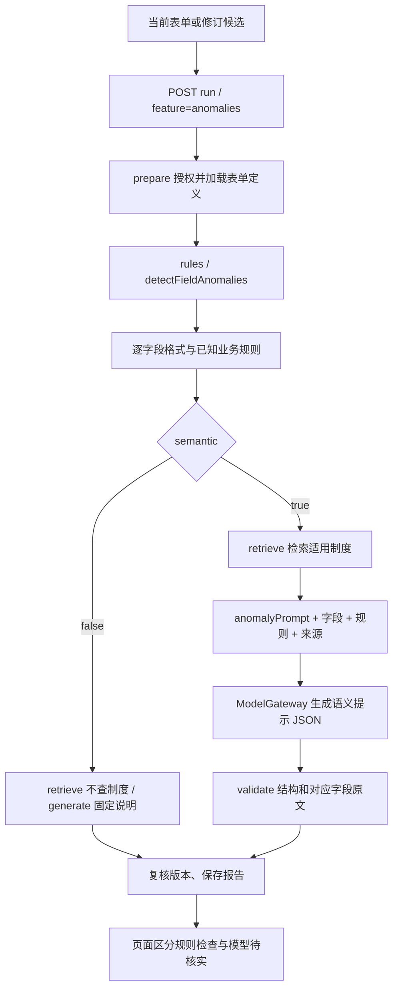

# 05 · 异常字段检测：让规则和模型各做擅长的事

[学习总入口](README.md) · 前置：[基础篇](00-foundations.md) · 第一次先读规则部分，学完 RAG 再看语义部分

## 一、本篇目标

跟踪 `feature=anomalies` 的两个模式：`semantic=false` 只跑代码规则，`semantic=true` 在规则后增加模型语义检测。分清“格式错误”“业务提醒”“模型待核实”，并理解它们不会自动驳回申请。

例子一：金额是 `-1`，发生日期是 `2099-11-20`。代码足以发现值得核实的问题。

例子二：金额填 `420`，说明写“客户打车实际支付800元”。两个字段各自格式都合法，但彼此可能矛盾，适合模型补充提醒。

## 二、先分清两类检查

| 类型         | 擅长什么                         | 例子                                     | 来源标识       |
| ------------ | -------------------------------- | ---------------------------------------- | -------------- |
| 确定性规则   | 明确、可复现、可写边界测试的判断 | 必填为空、非法日期、金额非正数           | `source=rule`  |
| 模型语义检查 | 理解文字中的跨字段关系           | 说明金额与 amount 冲突、用途和分类不一致 | `source=model` |

`severity=error` 通常表示明确的缺项/格式问题，`warning` 表示需要核实的线索。这是助手报告的提示级别，不是自动审批状态。

共享 `validateForm()` 在业务提交时仍会执行原来的校验。助手指出问题，不等于把所有 warning 都新增为业务硬拦截规则。

## 三、分两遍读完整链路



### 第一遍：只看不用模型的规则链

**1. 页面选择检查对象。** 发起页分析当前 `draft`；详情页非当前审批人使用已保存表单，当前审批人可分析候选修订。打开 [assistant-panel.tsx](../../../apps/web/src/components/assistant/assistant-panel.tsx)，搜索 `semantic`：页面复选框“同时检测语义矛盾（调用所选模型）”控制这个布尔值。

**2. prepare 先校验权限。** 在 [assistant.service.ts](../../../apps/api/src/assistant/assistant.service.ts) 的 `context()`，已有申请必须是参与人；传入候选 `data` 还需要是当前待办审批人。候选字段 key 不能超出流程定义。

**3. rules 调纯函数。** 打开 [assistant-checks.ts](../../../packages/bpm-core/src/assistant-checks.ts)，只看 `detectFieldAnomalies()`：

| 代码顺序            | 检查什么                             | 为何这样组织                                  |
| ------------------- | ------------------------------------ | --------------------------------------------- |
| 遍历 `def.fields`   | 每个字段的必填、类型、选项、合法日期 | 单字段调用 `validateForm()`，可以收集多项错误 |
| catch 后 continue   | 格式不合法先报告 error               | 不对不可靠的日期/数字继续做业务比较           |
| 空值判断            | 跳过未填的可选字段                   | 避免 `Number('')` 变成 0，误报非正数          |
| amount / days 规则  | 已知金额/天数小于等于 0 时提醒       | 不给任意自定义数字都套上“必须正数”            |
| 费用发生日规则      | 报销 `date` 晚于上海今天时提醒       | 请假可以在未来，不能对所有分类一刀切          |
| startDate / endDate | 两者都有值时检查前后顺序             | 缺项仍由各自字段规则负责                      |

所以负金额在当前助手里是 warning；非法日历日期一般是 error。负温度等自定义数值不会因为是负数就继承报销金额语义。

**4. 不需要模型时直接回答。** `semantic=false` 时 retrieve 返回空来源，generate 构造“已执行确定性字段检查，未执行模型语义检测”的说明，不调用 `ModelGateway.generate()`。

后面仍复核版本并保存建议报告。纯函数没有写库，但走 HTTP 的完整分析会保存报告。

### 第二遍：在规则后增加语义检查

**1. retrieve 准备可选制度。** `semantic=true` 时会调用同一套制度检索，细节见 [RAG 篇](04-policy-rag.md)。即便没有命中来源，仍可基于现有字段检查相互矛盾；语义检测与“制度问答无来源直接返回”的分支不同。

**2. generate 给模型明确任务。** 查看 [prompts.ts](../../../apps/api/src/assistant/prompts.ts) 的 `anomalyPrompt`：不重复已有规则，不把路线阈值当费用上限，只给真实字段提出待核实项，每项都要字段原值中的连续摘录。

模型可能输出这样的结构，实际文字不保证一致：

```json
{
  "text": "费用说明与金额字段可能不一致，需要核实。",
  "anomalies": [
    {
      "fieldKey": "reason",
      "message": "说明提到实际支付800元，与金额字段420元不同",
      "evidence": "实际支付800元"
    }
  ],
  "questions": [],
  "citationIds": []
}
```

`fieldKey=reason` 意味着引文必须来自 reason 的真实值，不能从 category 或整段无关上下文搬来。Ollama 原生 schema 还可能把 evidence 限制为完整字段值；引用整个 reason 同样可以被校验。

**3. validate 核对原文后再保留。** 回 Service 搜索 `for (const anomaly of out.anomalies)`：

1. 该 `fieldKey` 在定义中是否存在？
2. `locateEvidence(对应字段原值, anomaly.evidence)` 能否找到真实片段？
3. 找不到就排除这条模型提示并加 warning。
4. 找得到才追加 `source=model`、`severity=warning` 的 finding，并加“待核实”前缀。

模型原始输出用 `anomalies`；最终公共响应统一放在 `findings`。规则结果已经先存进去，保留的模型项是追加，不覆盖它们。

依据定位只检查“这句话是否来自对应字段”，并没有自动证明该判断的语义正确。比如一句包含 800 的说明未必是在说报销总额，还要人理解业务。

### 失败时保留到什么程度

generate 中对模型调用异常做了降级：如果模型生成/解析调用失败，仍可返回先前的规则发现，并明确“语义检测未完成”。这是有范围的处理：

| 情况                              | 当前行为                                      |
| --------------------------------- | --------------------------------------------- |
| `ModelGateway.generate()` 抛错    | 异常检测分支保留规则结果，附失败说明          |
| 某条语义提示原文不匹配            | 排除该条，保留已通过规则及其他有效提示        |
| 检索阶段 Embedding 报错           | 发生在 generate 之前，当前可能整次请求失败    |
| 生成对象不符合最终 `outputSchema` | validate 阶段拒绝整份结构，不属于调用异常降级 |
| 权限不满足或业务版本已变          | 拒绝，不把旧/越权报告当成当前有效结果         |

理解这些边界，排错时才不会以为“任何模型相关错误都保证返回部分结果”。

## 四、亲手验证与练习

### 页面实验 A：先关闭模型

1. 在费用报销发起页填写类型和说明，金额填 -1，日期填 `2099-11-20`。
2. 选择异常字段检测，取消“同时检测语义矛盾”。
3. 生成后应看到金额非正数、未来费用日期的规则提醒。
4. 看返回值的 `findings[*].source`，应为 `rule`。没有对话模型也能做这个实验。
5. 先不提交这份教学候选，改回正常值，重新生成比较结果。

### 页面实验 B：再打开语义检查

金额改为 420，说明写“客户打车实际支付800元”，使用合法发生日，勾选语义检测。选择本机模型生成，观察是否出现“模型待核实”，并核对引用来自哪一个字段。

模型可能漏检，也可能提出不恰当的线索，所以语义实验观察质量，不把“必定出现某句话”当稳定断言。代码规则的复现性与模型提示的质量是两种测试目标。

### 接口实验 A：纯规则

先执行基础篇的公共函数：

```powershell
$anomalyRulePayload = @{
  feature = 'anomalies'
  workflowId = $lessonWorkflowId
  semantic = $false
  data = @{ category = '差旅交通'; amount = -1; date = '2099-11-20'; reason = '客户出行费用' }
}
$ruleResult = Invoke-AssistantLesson -Payload $anomalyRulePayload
$ruleResult.findings | Format-Table source, severity, fieldKey, message
```

预期出现 amount 与 date 的规则提醒，且没有执行模型语义检测。

### 接口实验 B：语义补充

```powershell
$modelResult = Invoke-AssistantLesson -Payload @{
  feature = 'anomalies'
  workflowId = $lessonWorkflowId
  semantic = $true
  data = @{ category = '差旅交通'; amount = 420; date = '2026-11-18'; reason = '客户打车实际支付800元' }
  model = @{ provider = 'ollama'; model = 'qwen3.5:2b' }
}
$modelResult | Select-Object text, findings, warnings | ConvertTo-Json -Depth 12
```

关注 source、evidence、warnings，不只是读主体概述。若启用了向量检索，还需保证向量服务可用。

### 稳定测试与动手练习

```powershell
pnpm --filter @bpm/core exec tsx --test --test-name-pattern 'anomalies|custom numeric' test/assistant.test.ts
```

预期异常规则与自定义数值两项测试通过。再读 [API 助手测试](../../../apps/api/test/assistant.test.ts) 的：

- `anomalies preserve deterministic findings when semantic model fails`。
- `unsupported semantic claims are discarded while grounded rule findings remain`。

练习：假设新增自定义字段 `temperature=-5`，它应该自动报“应大于0”吗？答案：不应该，正负值语义需要业务定义。假设模型给 reason 提示却引用不存在的“已提供发票”，应该怎么办？答案：排除该条并提示，不能伪造证据。

## 五、常见问题

| 问题                          | 原因与处理                                                   |
| ----------------------------- | ------------------------------------------------------------ |
| 超过 3000 为什么没有“违规”？  | 这是路线阈值，不是已实现的费用上限规则                       |
| 模型不可用，规则是否还有用？  | 有，关闭语义检测可以独立运行；部分调用错误也会降级           |
| 没发现异常就代表合规吗？      | 只表示本次执行的检查未发现问题，不证明票据真实或制度全部满足 |
| 检测出 warning 会自动驳回吗？ | 不会，正式审批仍走原业务入口                                 |
| 为什么要记录 source？         | 人需要知道哪些判断可由代码复算，哪些只是模型线索             |
| 修改表单后旧提示还能用吗？    | 旧结果标记过期，应按新表单重新检测                           |

完成后回到 [学习入口的空表](README.md)，试着不看文章填出这条链路。能解释两种模式、证据检查和业务提交边界，就已经掌握这项功能的主干。
