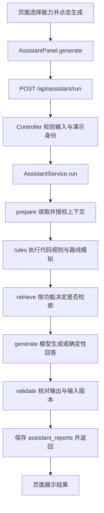

# 从零读懂审批助手：五条能力链路

这套文档写给第一次接触 Agent、LangGraph 和 RAG 的同学。学习目标是：点一次页面按钮后，能说清数据经过哪些文件、谁负责判断、结果怎样回到页面，以及哪一步才真的提交审批。

每次只读一篇，打开文章里列出的文件，用编辑器搜索函数名。先会跟踪一份数据，再理解框架的全部 API。

## 先看学习地图

五项能力是**同一个助手编排的五种功能**，不是五个独立进程，也没有五个互相聊天的 Agent。前端发送 `feature`，后端在图节点内部选择处理分支。

| 对应需求        | 单独的学习文档                                                 | feature     | 是否调用对话模型       | 是否检索制度           |
| --------------- | -------------------------------------------------------------- | ----------- | ---------------------- | ---------------------- |
| 基础准备        | [00 · 术语、目录、公共链路与实验工具](00-foundations.md)       | —           | 先建立概念             | 先建立概念             |
| 1. 审批意见草稿 | [01 · 从申请事实到可编辑的意见](01-approval-draft.md)          | `draft`     | 是                     | 是，未命中也可以起草   |
| 2. 路线解释     | [02 · 从当前表单到实际/假设路线](02-route-explanation.md)      | `route`     | 否                     | 否                     |
| 3. 自然语言填单 | [03 · 从一句话到有依据的候选字段](03-natural-language-form.md) | `fill`      | 是                     | 否                     |
| 4. 制度 RAG     | [04 · 文档入库链与问答检索链](04-policy-rag.md)                | `policy`    | 命中来源后调用         | 是                     |
| 5. 异常字段检测 | [05 · 规则检查与模型语义检查](05-anomaly-detection.md)         | `anomalies` | `semantic=true` 时调用 | `semantic=true` 时检索 |

“否”表示不调用这类模型或检索；通过 API 运行时仍需要 PostgreSQL 读取流程、复核版本、保存报告。只有抽出来的纯规则函数可以脱离数据库运行。

## 小白推荐顺序

建议按 **00 → 02 → 05 的规则部分 → 03 → 01 → 04 → 回看 05 的语义部分** 学习。先看完全由代码决定的流程，再加入模型，最后理解文档检索。编号保持与你提出的五项需求一致，不代表难度顺序。

| 学习步 | 这一遍只解决一个问题       | 完成标志                                                       |
| ------ | -------------------------- | -------------------------------------------------------------- |
| 第一步 | 页面如何把 JSON 发到后端？ | 找到 `generate()`、Controller 的 `run()` 和 Service 的 `run()` |
| 第二步 | 不调用模型，如何解释路线？ | 解释金额 3000 和 3000.01 的区别                                |
| 第三步 | 规则如何发现异常？         | 关闭语义检测，仍能查出负金额                                   |
| 第四步 | 模型如何把话变成字段？     | 区分 `amount`、`label` 和 `fieldEvidence`                      |
| 第五步 | 为什么“填入意见”还没审批？ | 找到 `onDraft` 和真正的 `/tasks/:id/actions` 两个入口          |
| 第六步 | RAG 为什么有两条链？       | 分别画出导入时和提问时的数据流                                 |
| 第七步 | 如何判断模型提示能否保留？ | 解释原文依据校验能证明什么、还有什么需要人工核对               |

## 所有能力共用的主干

五个图节点的顺序固定，差别在节点内部。每篇文章会把自己的分支展开，不需要边读边猜“这条功能是不是跳过了整个图”。

`steps` 只记录部分可读处理阶段，供页面展开查看；它不是所有函数调用的完整日志。调试时要结合代码和 Network 请求一起看。

## 每篇文章怎样使用

每篇都包含五部分：学完能做什么 → 用人话解释新概念 → 按文件追踪链路 → 页面/接口实验与练习 → 真实常见问题。

建议一边读，一边记下面这张空表，而不是抄下全部源码：

| 我要追踪什么                | 自己填答案 |
| --------------------------- | ---------- |
| 页面入口、按钮名称          |            |
| 请求里的 feature 与关键字段 |            |
| 后端读取了什么真实业务数据  |            |
| 哪些结论由代码决定          |            |
| 模型输入、模型原始输出      |            |
| 输出经过什么检查            |            |
| 结果返回到了哪个状态变量    |            |
| 何时才会改变业务实例/待办   |            |

## 与已有 stage 文档的关系

原来的 [stage-6](../../stage-06-approval-assistant.md) 讲“这一阶段增加了什么”；本目录讲“当前实现的每项能力具体怎样工作”。本次新增的是阅读教材，不新增工程阶段，也不移动原有 `stage-0` 至 `stage-6` 标签。

讲解依据是 **2026-11-20 当前代码**，包含 `stage-6` 之后的 Qwen 填单依据恢复、逐字段保留和日期候选修复。学习这些修复时，请留在当前完整分支；旧 `stage-6` 快照不包含后续改动。

本次用技能的 `assess_history.py` 做了只读历史体检，结果为 97 分/A 档。保留已有阶段脉络；前期阶段本来就是教学重组快照，这个分数不代表全部原始开发过程。五项能力按当前调用关系拆解，不把配置整理提交当作新的业务学习阶段。

新增教材文件就是本目录的入口、基础篇和五篇能力文档；同步更新项目 README、docs 入口、助手规划入口、配置指南与 stage-6 的导航。业务代码不因这套教材发生变更。

开始阅读：[00 · 基础准备](00-foundations.md)。运行不通先查 [助手配置指南](../setup.md) 和 [工程启动说明](../../startup.md)。
