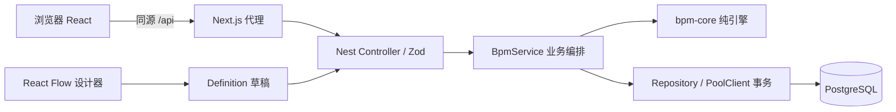
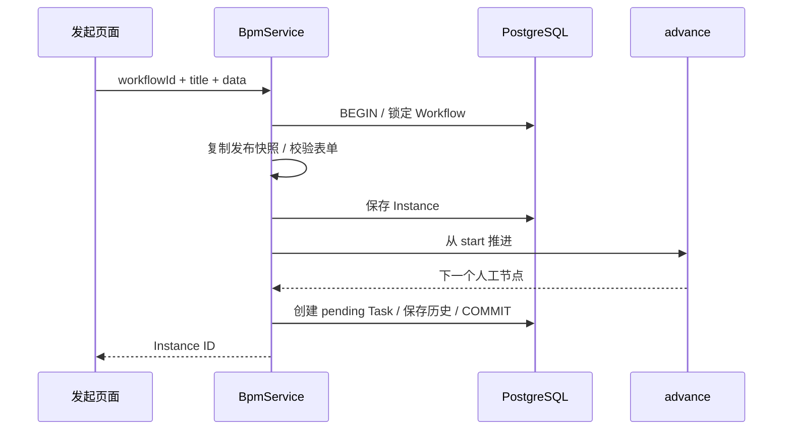

# 全局架构：跑通一份申请后再读

## 依赖方向

前后端都依赖 `@bpm/core`，互相不引用对方源码。参考 aiflow 的是这一分层方式和发布快照思路，不是拷贝其 AI 节点/插件系统。BPM 需要在人工节点暂停，区别于一次同步跑完的 AI 工作流。

## 五个关键数据对象

| 对象             | 保存什么                               | 修改规则                                 |
| ---------------- | -------------------------------------- | ---------------------------------------- |
| Definition       | 元信息、nodes、edges、fields           | 设计态自由编辑，发布时必须通过校验       |
| Workflow         | draft、versions、revision、enabled     | draft 可改；versions 追加；revision 递增 |
| PublishedVersion | 版本号、完整 Definition、发布时间      | 发布后不会被业务入口改写                 |
| Instance         | 申请表单、运行状态、定义快照、审计历史 | 按审批推进，始终执行自己保存的快照       |
| Task             | 实例、当前人工节点、处理人、状态       | pending 只能完成一次                     |

## 一次提交与一次审批

审批使用另一个事务：锁住 Task → 校验处理人和 pending 状态 → 锁 Instance → 校验修订表单 → 完成旧 Task → advance → 创建下个 Task 或标记 completed → 保存历史 → 提交。任何错误都回滚。

两次请求同时审批时，第二次在行锁等待，随后读取已更新任务并返回 409。不同实例使用不同行锁，仍可并发处理。发布与发起共用 Workflow 行锁，保证发起得到确定版本。

## PostgreSQL 存储取舍

三个独立表保存 JSONB 文档，适合节点和表单不断变化的教学模型。实例的 workflow_id、任务的 instance_id/status 和业务编号通过生成列提取，建立外键、唯一约束和索引。JSONB 不是“数据库不校验”的理由。

序列生成并发安全编号，事务回滚可能出现空号。不要依赖编号连续性。列表为了教学简单一次读取全部文档；数据量增长时应增加按处理人、状态的索引与分页查询。审计历史存在实例文档中，正式系统可独立成只追加事件表并限制数据库写权限。

## 扩展建议

| 需求       | 首先修改哪里                                      | 要补什么验证                       |
| ---------- | ------------------------------------------------- | ---------------------------------- |
| 新表单类型 | core types/validateForm → FormFields → 属性面板   | 客户端展示与服务端校验一致         |
| 新自动节点 | core 类型/发布规则/advance → move 审计 → 画布节点 | 自动链路、错误回滚、执行步数上限   |
| 并行会签   | 先改执行 token/汇聚模型和唯一任务约束             | 多分支汇合、多人完成规则、重复回调 |
| 登录与权限 | Controller 前增加可信会话/Guard                   | 伪造用户、越权查看、管理权限       |
| 退回修改   | 先定义实例与任务状态迁移                          | 旧待办作废、快照策略与完整历史     |
| 实时通知   | 事务提交后发布事件                                | 回滚不发通知、重复投递幂等         |

不要先在画布加按钮再临时拼执行语义。先明确状态与不变量，再实现引擎和持久化，最后接 UI。
