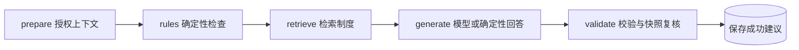

# 阶段 6 · LangGraph 审批助手与制度 RAG

> 代码快照：`stage-6`。上一阶段：`stage-5`。

## 一、本阶段目标

能切换 Ollama / OpenAI 兼容模型，使用五项助手能力，并理解“确定性业务规则、模型生成、检索依据”如何在同一条 LangGraph 链路中配合。

实际运行效果：一句话提取表单候选值，查看真实/假设路线，起草意见，导入制度后带引用问答，检查字段异常；正式提交仍走原 BPM 接口。

## 二、新引入的概念

### 2.1 LangGraph 共享状态

一个函数负责所有事情时，模型、数据库、检索和校验容易混在一起。图把它们拆成节点：



每个节点读取 state，返回局部更新，编译后由 `invoke` 执行。图是助手内部编排，不是设计器里业务流程的替代品。BPM 等待人审批，助手返回建议，两个状态机的职责不同。

### 2.2 模型适配与约束解码

LangChain 的 ChatOllama、ChatOpenAI 隔离协议差异。页面只选 provider/model，服务端配置地址与密钥。

Ollama 根据本次功能构造 JSON schema 约束解码，例如填单不允许生成任意 citationIds。OpenAI 兼容端点不假定支持同样的原生能力，统一通过提示词与服务端 Zod 校验兜底。结构合法不代表事实正确，所以还需要字段白名单、数值校验、原文摘录与引用检查。

### 2.3 RAG 的检索与生成分工

制度先解析、切分、建立索引，查询时先检索适用片段，再交给模型回答。模型不能凭记忆补公司制度。

默认词项检索无需向量模型；向量模式额外调用 Embedding，通过 profile 与维度检查避免混用不同向量空间。索引与原文在 PostgreSQL，当前用教学规模的扫描实现。

## 三、按这个顺序阅读代码

1. `packages/bpm-core/src/assistant.ts`：先看输入 feature 和统一结果，注意 ModelChoice 不包含密钥。
2. `assistant-checks.ts`：读 `detectFieldAnomalies`、`explainRoute`、`locateEvidence`。金额阈值不是合规上限；空白归一化只为定位原文，不能改写事实。
3. `apps/api/src/assistant/model-gateway.ts`：配置摘要 → provider 分支 → invoke → JSON 解析；再看 Embedding 独立配置。
4. `output-schema.ts` 与 `prompts.ts`：为什么每项功能使用短提示，为什么仅有“请输出 JSON”还不够。
5. `policy.service.ts`：提取文件 → RecursiveCharacterTextSplitter → 可选向量 → 一次落库 → 生效期/版本过滤 → 混合检索。
6. `assistant.service.ts`：沿图节点阅读，再读 `context()` 中的参与人、候选表单和当前处理人检查。
7. `assistant.controller.ts`：HTTP 输入校验、演示角色与接口边界；模型没有获得批准/驳回工具。
8. `apps/web/src/components/assistant/model-picker.tsx`：默认值与本机偏好、模型列表失败时的手动输入。
9. `assistant-panel.tsx`：contextKey、AbortController、旧结果过期与“采用后仍不提交”。
10. 回到 `runtime/start-process.tsx` 与 `runtime/instance-detail.tsx`：AI 候选值如何进入受控表单，意见如何填入原提交区域。
11. `knowledge-page.tsx`：文件编码、显式上传、版本与停用；服务端并不信任浏览器文件限制。
12. `packages/bpm-core/test/assistant.test.ts` 和 `apps/api/test/assistant.test.ts`：先看业务不变量，再看外部模型替身。

**重点**：不要在持有审批行锁的事务里等待模型。报告不是审批事件，生成意见不改变 Task。定义、实例快照和用户当前候选值也不能混成同一种数据。

## 四、如何验证与练习

配置详见 [助手运行指南](agent/setup.md)。依赖新增，切换到本阶段后先重新安装：

```powershell
pnpm install --frozen-lockfile
pnpm db:up
pnpm dev
```

1. 在制度库导入 `docs/examples/expense-policy.md`，分类选费用报销。
2. 在费用报销发起页输入：“申请报销2026年11月18日的差旅交通费420元，用于客户项目现场交付。”
3. 生成候选值，核对原文，点击填入后再提交。
4. 当前处理人进入详情生成路线解释：420 走否则分支；在候选表单改为 3000.01 后再生成，应进入财务路径，真实历史仍不变。
5. 生成同意/驳回意见草稿，填入意见；不点击业务按钮时 Task 必须保持 pending。
6. 候选表单改为负数金额和未来发生日，执行异常检测；观察规则与模型提示的来源区别，再取消修改。
7. 制度问答展开引用，停用相关制度后再问；无匹配时不得生成有依据的肯定结论。

```powershell
pnpm test
pnpm typecheck
pnpm comments:check
pnpm format:check
pnpm build
```

业务测试使用独立 `_test` 数据库和模型替身，不需要外部 key。兼容端点测试使用本地 HTTP 服务验证 ChatOpenAI 的实际请求。真实模型质量还要单独评估，单元测试不会证明语言理解永远正确。

练习：新增一个仅作用于采购的规则；为制度设置生效期并验证历史费用日期；更换 Embedding 后观察旧索引的关键词回退；让无关用户读取某申请助手上下文，解释为何被拒绝。

## 五、常见问题

- **模型生成了 JSON 但字段结构不对**：小模型曾把 fieldEvidence 写成数组；Ollama 使用按功能收紧的约束 schema，服务端仍做后验校验。
- **原文是 420元，引用变成 420 元**：只归一化空白来定位，再恢复真实原文；430元不能因此通过。
- **填单有未填写项**：缺少事实时保留为空并列待确认，不自动编造。已知“，用于…”用途短语可直接复制给 reason，其他提取仍需核对。
- **关键词模式与向量模式是不是两套制度库**：同一张表；向量 profile 不匹配时不做跨空间比较，正文仍可关键词召回。
- **PDF 能解析但没有文字**：扫描件没有可提取文本，先做 OCR；本工程不会声称已看懂扫描图。
- **模型说的路线与引擎不一致**：路线事实以纯引擎结果为准；阅读意见时仍应核实，不能让模型重算流程条件。
- **生成途中切换身份或改表单**：前端放弃旧响应；后端重新检查业务快照，阻止过期结果保存为当前建议。

## 六、本阶段文件变更清单

完整清单见 [stage-06 变更记录](changes/stage-06.md)。新增助手协议/规则、LangGraph 服务、模型适配、制度解析检索、前端助手/制度库、测试、配置与运行说明；原 BPM 引擎继续承担业务执行。
